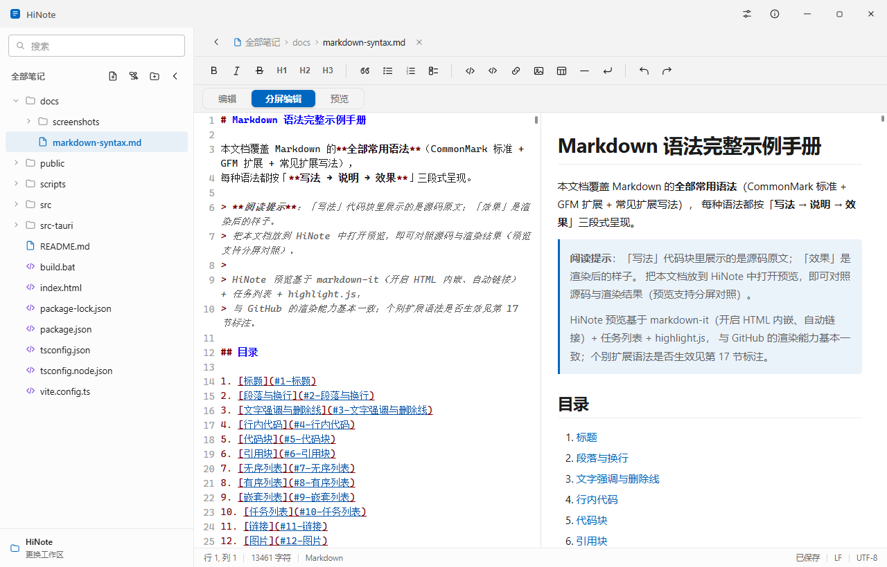
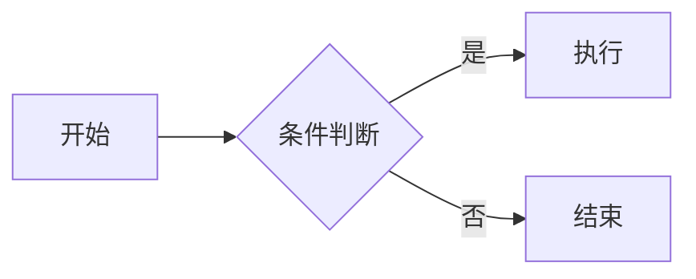

# Markdown 语法完整示例手册

本文档覆盖 Markdown 的**全部常用语法**（CommonMark 标准 + GFM 扩展 + 常见扩展写法），
每种语法都按「**写法 → 说明 → 效果**」三段式呈现。

> **阅读提示**：「写法」代码块里展示的是源码原文；「效果」是渲染后的样子。
> 把本文档放到 HiNote 中打开预览，即可对照源码与渲染结果（预览支持分屏对照）。
>
> HiNote 预览基于 markdown-it（开启 HTML 内嵌、自动链接）+ 任务列表 + highlight.js，
> 与 GitHub 的渲染能力基本一致；个别扩展语法是否生效见第 17 节标注。

## 目录

1. [标题](#1-标题)
2. [段落与换行](#2-段落与换行)
3. [文字强调与删除线](#3-文字强调与删除线)
4. [行内代码](#4-行内代码)
5. [代码块](#5-代码块)
6. [引用块](#6-引用块)
7. [无序列表](#7-无序列表)
8. [有序列表](#8-有序列表)
9. [嵌套列表](#9-嵌套列表)
10. [任务列表](#10-任务列表)
11. [链接](#11-链接)
12. [图片](#12-图片)
13. [表格](#13-表格)
14. [水平分割线](#14-水平分割线)
15. [转义字符](#15-转义字符)
16. [内嵌 HTML](#16-内嵌-html)
17. [扩展语法（渲染器依赖）](#17-扩展语法渲染器依赖)
18. [语法速查表](#18-语法速查表)

---

## 1. 标题

### 1.1 ATX 式标题（# 号）

**写法**

````markdown
# 一级标题
## 二级标题
### 三级标题
#### 四级标题
##### 五级标题
###### 六级标题
````

**说明**：行首 1~6 个 `#` 对应 h1~h6，`#` 与文字之间**必须有一个空格**（`#标题` 不会被解析为标题）。超过 6 个 `#` 按普通文本处理。Markdown 只有 6 级标题，没有 h7。

**效果**

# 一级标题
## 二级标题
### 三级标题
#### 四级标题
##### 五级标题
###### 六级标题

### 1.2 闭合式标题（尾部加 #）

**写法**

````markdown
## 这也是二级标题 ##
### 闭合 # 号数量不必相等 ###
````

**说明**：标题尾部可以加任意数量的 `#` 作为闭合标记，渲染时自动忽略。闭合 `#` 前要有空格，纯粹是装饰性写法。

**效果**

## 这也是二级标题 ##

### 1.3 Setext 式标题（下划线）

**写法**

````markdown
一级标题用等号线
================

二级标题用短横线
----------------
````

**说明**：文字下一行写 `===`（≥1 个）得到一级标题，写 `---`（≥1 个）得到二级标题。注意：`---` 紧跟在文字行下方是 Setext 标题，只有与上方文字**隔开空行**时才是水平分割线（见第 14 节）。

**效果**

一级标题用等号线
================

二级标题用短横线
----------------

## 2. 段落与换行

### 2.1 段落

**写法**

````markdown
这是一个段落。段落由多行文字组成，
中间没有空行。

这是另一个段落，与前一段之间隔了一个空行。
````

**说明**：段落之间用**空行**分隔（空行里可以有空格/制表符，但没有可见字符）。没有空行的多行文字属于同一个段落。

**效果**

这是一个段落。段落由多行文字组成，
中间没有空行。

这是另一个段落，与前一段之间隔了一个空行。

### 2.2 段内强制换行

**写法**

````markdown
这一行行尾有两个空格（此处不可见）  
于是渲染成了换行。

另一种写法：行尾放一个反斜杠\
也能强制换行。
````

**说明**：Markdown 默认把段内的单个换行**合并为一个空格**（HiNote 预览也是此行为）。要真正换行有两种办法：行尾加**两个及以上空格**，或行尾加**反斜杠 `\`**。中文写作推荐用反斜杠，避免行尾空格不可见、易被编辑器自动清除。

**效果**

这一行行尾有两个空格（此处不可见）  
于是渲染成了换行。

另一种写法：行尾放一个反斜杠\
也能强制换行。

## 3. 文字强调与删除线

### 3.1 粗体 / 斜体 / 粗斜体

**写法**

````markdown
*星号单层 = 斜体*
_下划线单层 = 斜体_

**星号双层 = 粗体**
__下划线双层 = 粗体__

***星号三层 = 粗斜体***
**_混合写法 = 粗斜体_**
````

**说明**：单层符号是斜体、双层是粗体、三层是粗斜体。`*` 与 `_` 等价，但 `_` 要求与中文之间留有空格（CommonMark 规则：`_` 两侧不能直接贴着字母数字），**中文内容建议统一用 `*`**。定界符必须紧贴文字，`* 斜体 *` 中间的空格会使语法失效。

**效果**

*星号单层 = 斜体*
_下划线单层 = 斜体_

**星号双层 = 粗体**
__下划线双层 = 粗体__

***星号三层 = 粗斜体***
**_混合写法 = 粗斜体_**

### 3.2 删除线

**写法**

````markdown
~~这两个波浪号之间的文字会被划掉~~
````

**说明**：`~~文字~~`（GFM 扩展）渲染为删除线。波浪号必须紧贴内容两端。

**效果**

~~这两个波浪号之间的文字会被划掉~~

### 3.3 强调嵌套

**写法**

````markdown
**粗体里面嵌 *斜体* 效果**
*斜体里面嵌 **粗体** 效果*
**粗体里放 ~~删除线~~ 也可以**
````

**说明**：强调符号可以互相嵌套，只要开闭配对正确。嵌套时注意每种符号独立成对。

**效果**

**粗体里面嵌 *斜体* 效果**
*斜体里面嵌 **粗体** 效果*
**粗体里放 ~~删除线~~ 也可以**

## 4. 行内代码

**写法**

````markdown
行内代码用反引号包裹：`npm install`，常用于命令、变量、文件名。

想显示反引号本身，用两个反引号作定界符：``这里有一个 ` 反引号``。

行内代码里 *不解析* 任何 Markdown 语法：**这不是粗体**。
````

**说明**：一对反引号包裹的内容按等宽字体原样显示，内部所有 Markdown 符号失效。若内容本身含反引号，定界符改用**两个（或多个）反引号**，且与内容之间留空格。

**效果**

行内代码用反引号包裹：`npm install`，常用于命令、变量、文件名。

想显示反引号本身，用两个反引号作定界符：``这里有一个 ` 反引号``。

行内代码里 *不解析* 任何 Markdown 语法：**这不是粗体**。

## 5. 代码块

### 5.1 围栏式代码块（推荐）

**写法**

````markdown
```javascript
// 用 ``` 加语言名开启，语法着色
function greet(name) {
  return `Hello, ${name}!`;
}
```
````

**说明**：用三个反引号（或三个 `~`）围栏包住代码块，开栏后紧跟**语言名**可获得语法高亮（HiNote 支持 20+ 语言，未标注语言时会自动探测）。代码块内**所有 Markdown 语法全部失效**，原样显示——这也是展示 Markdown 源码本身的标准方式。

**效果**

```javascript
// 用 ``` 加语言名开启，语法着色
function greet(name) {
  return `Hello, ${name}!`;
}
```

### 5.2 波浪线围栏与反引号块中含反引号

**写法**

````markdown
~~~
当代码内容里本身包含 ``` 时，
外层围栏可改用 ~~~ 波浪线，
或把外层围栏加长为 4 个以上反引号。
~~~
````

**说明**：反引号围栏内不能再出现三个连续反引号，否则会提前闭合。用 `~~~` 作外层围栏、或把外层围栏写成 4 个以上反引号即可规避（本文档所有「写法」代码块就是这么嵌套出来的）。

**效果**

~~~
当代码内容里本身包含 ``` 时，
外层围栏可改用 ~~~ 波浪线，
或把外层围栏加长为 4 个以上反引号。
~~~

### 5.3 缩进式代码块

**写法**

````markdown
普通段落：

    每行前加 4 个空格（或 1 个 Tab）
    就构成缩进式代码块

回到正常段落。
````

**说明**：段落后的每行缩进 4 个空格（或 1 个 Tab）即成为代码块，无法指定语言，现代写作更推荐围栏式。注意在**列表项内部**需要缩进 8 个空格才能构成代码块。

**效果**

普通段落：

    每行前加 4 个空格（或 1 个 Tab）
    就构成缩进式代码块

回到正常段落。

## 6. 引用块

### 6.1 基本引用

**写法**

````markdown
> 这是一段引用。行首以 > 开头。
> 每行都加 > 是规范写法，
> 换行不写 > 也能延续（惰性续行），
但建议每行都写，源码更清晰。
````

**说明**：行首 `>` 构成引用块。只有第一行写 `>` 时，后续行会自动并入（惰性续行），但推荐每行都写 `>`。

**效果**

> 这是一段引用。行首以 > 开头。
> 每行都加 > 是规范写法，
> 换行不写 > 也能延续（惰性续行），
但建议每行都写，源码更清晰。

### 6.2 嵌套引用

**写法**

````markdown
> 第一层引用
>> 第二层引用
>>> 第三层引用
>
> 回到第一层
````

**说明**：连续多个 `>` 表示层级加深（`>>` 是二层，`>>>` 是三层）。从深层退回浅层时，用一个单独的浅层 `>` 行衔接，或用空行分隔。

**效果**

> 第一层引用
>> 第二层引用
>>> 第三层引用
>
> 回到第一层

### 6.3 引用内嵌套其他元素

**写法**

````markdown
> ### 引用里可以有标题
>
> - 也可以有列表
> - 第二项
>
> ```python
> # 甚至代码块
> print("hello")
> ```
>
> **粗体**、`行内代码`、[链接](https://example.com) 一样可用。
````

**说明**：引用内所有 Markdown 语法照常解析，嵌套块级元素（列表、代码块、标题）时保持 `>` 前缀并注意空行与缩进。

**效果**

> ### 引用里可以有标题
>
> - 也可以有列表
> - 第二项
>
> ```python
> # 甚至代码块
> print("hello")
> ```
>
> **粗体**、`行内代码`、[链接](https://example.com) 一样可用。

## 7. 无序列表

**写法**

````markdown
- 减号开头的列表项
* 星号开头的列表项
+ 加号开头的列表项

- 同一列表建议统一符号
- 列表项之间的空行可以省略
- 一行一项，符号后要有空格

- 列表项可以很长，
  续行缩进对齐（或不缩进，惰性并入）。
````

**说明**：`-`、`*`、`+` 均可作无序列表标记，符号后需空格。同一层混用符号可能被解析为**不同列表**，建议全文统一用 `-`。

**效果**

- 减号开头的列表项
* 星号开头的列表项
+ 加号开头的列表项

- 同一列表建议统一符号
- 列表项之间的空行可以省略
- 一行一项，符号后要有空格

- 列表项可以很长，
  续行缩进对齐（或不缩进，惰性并入）。

## 8. 有序列表

**写法**

````markdown
1. 第一项
2. 第二项
3. 第三项

4. 起始数字决定列表编号起点
5. 渲染时自动按顺序编号

1) 圆括号也是合法的定界符
2) 但冒号点号更常见
````

**说明**：数字 + `.`（或 `)`）+ 空格构成有序列表。**起始项的数字决定渲染起点**（上面第二组会从 4 开始编号），后续数字写错没关系，渲染时自动递增。想强制从 1 开始就保证首项是 `1.`。

**效果**

1. 第一项
2. 第二项
3. 第三项

4. 起始数字决定列表编号起点
5. 渲染时自动按顺序编号

1) 圆括号也是合法的定界符
2) 但冒号点号更常见

## 9. 嵌套列表

**写法**

````markdown
- 一级项
  - 二级项（缩进 2 空格，与上级内容对齐）
    - 三级项（再缩进 2 空格）
  - 回到二级
- 回到一级

1. 有序列表也能嵌套
   1. 二级有序
   - 二级无序（可混合）
2. 回到一级

- 列表项内放段落：

  缩进的这段文字属于上面的列表项。

- 列表项内放代码块：

  ```bash
  echo "需要再缩进 2~4 空格"
  ```
````

**说明**：子列表靠**缩进**实现，缩进量需对齐父项的文字位置（无序一般 2 空格、有序一般 3 空格，多缩也可以）。列表项内放段落、代码块等块级内容时，先空一行，再缩进到与列表项文字对齐。

**效果**

- 一级项
  - 二级项（缩进 2 空格，与上级内容对齐）
    - 三级项（再缩进 2 空格）
  - 回到二级
- 回到一级

1. 有序列表也能嵌套
   1. 二级有序
   - 二级无序（可混合）
2. 回到一级

- 列表项内放段落：

  缩进的这段文字属于上面的列表项。

- 列表项内放代码块：

  ```bash
  echo "需要再缩进 2~4 空格"
  ```

## 10. 任务列表

**写法**

````markdown
- [ ] 未完成任务
- [x] 已完成任务
- [X] 大写 X 同样有效
- 普通列表项（无复选框）

- [ ] 嵌套任务
  - [x] 子任务
````

**说明**：列表项以 `[ ]`（未完成）或 `[x]`（已完成，大小写均可）开头即成任务列表（GFM 扩展，HiNote 支持）。`[` 与 `]` 内部不能有空格以外的字符，符号与方括号之间要有空格。

**效果**

- [ ] 未完成任务
- [x] 已完成任务
- [X] 大写 X 同样有效
- 普通列表项（无复选框）

- [ ] 嵌套任务
  - [x] 子任务

## 11. 链接

### 11.1 行内链接

**写法**

````markdown
[链接文字](https://example.com)

[带悬停提示的链接](https://example.com "鼠标悬停会显示这句话")
````

**说明**：`[文字](URL)` 是最常用写法；URL 后用引号包一句可选的 title，悬停时显示。URL 中有空格时用 `%20` 或尖括号 `<…>` 包裹。

**效果**

[链接文字](https://example.com)

[带悬停提示的链接](https://example.com "鼠标悬停会显示这句话")

### 11.2 引用式链接

**写法**

````markdown
参考 [Google][google] 与 [GitHub][gh]，也可以用简化写法[直接访问][]。

多次引用同一地址：再来一个 [Google][google] 链接。

[google]: https://google.com "搜索引擎"
[gh]: https://github.com "代码托管"
[直接访问]: https://example.com
````

**说明**：正文中写 `[文字][标识符]`，在文档任意位置（通常文末）集中定义 `[标识符]: URL`。同一 URL 被多处引用时正文更干净；标识符不区分大小写。省略第二个标识符（`[文字][]`）则以文字本身作为标识符。

**效果**

参考 [Google][google] 与 [GitHub][gh]，也可以用简化写法[直接访问][]。

多次引用同一地址：再来一个 [Google][google] 链接。

[google]: https://google.com "搜索引擎"
[gh]: https://github.com "代码托管"
[直接访问]: https://example.com

### 11.3 自动链接

**写法**

````markdown
尖括号式：<https://example.com>

裸链接自动识别：直接写 https://example.com 也会变成链接（GFM linkify）。

邮箱：<someone@example.com>
````

**说明**：`<URL>` 强制生成链接；HiNote 与 GitHub 开启了 linkify，正文里的裸 URL/邮箱会被自动识别为链接。自动链接要求 URL 完整（含协议）。

**效果**

尖括号式：<https://example.com>

裸链接自动识别：直接写 https://example.com 也会变成链接（GFM linkify）。

邮箱：<someone@example.com>

### 11.4 本地笔记间跳转

**写法**

````markdown
[跳转到同目录的其他笔记](./another.md)
[跳转到相对子目录](./notes/plan.md)
[锚点跳转](#18-语法速查表)
````

**说明**：链接目标写**相对路径**可跳转到工作区内的其他文档（HiNote 支持；GitHub 上跳转到仓库内文件）。`#锚点` 可跳到本文档的标题位置（锚点为小写化、空格换连字符后的标题文本，中文标题会保留中文）。

**效果**

[跳转到同目录的其他笔记](./another.md)
[跳转到相对子目录](./notes/plan.md)
[锚点跳转](#18-语法速查表)

## 12. 图片

### 12.1 行内图片

**写法**

````markdown



````

**说明**：语法与链接一致，只是开头多一个 `!`。方括号内是**替代文字**（图片加载失败时显示，也是无障碍朗读文本）。路径可以是相对当前笔记的路径（HiNote 会解析为本地文件预览）或 http(s) 网络地址。下面用本文档同目录的真实截图做演示。

**效果**


### 12.2 引用式图片

**写法**

````markdown
![徽标][shot]

[shot]: ./screenshots/HiNote-1.png "引用式定义的图片"
````

**说明**：与引用式链接同理，同一张图多次引用时更整洁。

**效果**

![徽标][shot]

[shot]: ./screenshots/HiNote-1.png "引用式定义的图片"

### 12.3 图片加链接（点击图片跳转）

**写法**

````markdown
[](https://example.com)
````

**说明**：把图片语法整体套在链接的方括号里，即可实现「点击图片跳转」。

**效果**

[](https://example.com)

## 13. 表格

### 13.1 基本表格与对齐

**写法**

````markdown
| 左对齐 | 居中 | 右对齐 |
| :----- | :--: | -----: |
| a      | b    | c      |
| 长一些的内容 | 1 | 2.50 |
````

**说明**：表头行 + 分隔行（`---` 组合）构成表格（GFM 扩展）。分隔行用冒号控制对齐：`:---` 左对齐、`:---:` 居中、`---:` 右对齐、`---` 默认左对齐。**表格前后需要空行**；源码里的竖线不必对齐，渲染结果一致。单元格内可用加粗、行内代码等内联格式。

**效果**

| 左对齐 | 居中 | 右对齐 |
| :----- | :--: | -----: |
| a      | b    | c      |
| 长一些的内容 | 1 | 2.50 |

### 13.2 单元格内换行与竖线转义

**写法**

````markdown
| 命令 | 说明 |
| ---- | ---- |
| `ls -l` | 第一行<br>第二行（用 <br> 换行） |
| `grep a\|b file` | 内容含竖线时写成 `\|` |
````

**说明**：表格单元格内不能用真实换行，需要换行时插入 `<br>`。内容本身含竖线 `|` 时必须转义为 `\|`，否则会被当作列分隔符。

**效果**

| 命令 | 说明 |
| ---- | ---- |
| `ls -l` | 第一行<br>第二行（用 <br> 换行） |
| `grep a\|b file` | 内容含竖线时写成 `\|` |

## 14. 水平分割线

**写法**

````markdown
三个及以上连续的减号：

---

星号或下划线同样有效：

***

_____
````

**说明**：一行中含 **3 个及以上**同类字符（`-`、`*`、`_`，中间可夹空格）即为分割线。注意两点：① 紧贴文字下一行的 `---` 会变成 Setext 二级标题（见第 1.3 节），分割线必须与上文隔空行；② `---` 也常被用作 YAML front matter 的包裹符（文件最顶部成对出现时）。

**效果**

三个及以上连续的减号：

---

星号或下划线同样有效：

***

_____

## 15. 转义字符

**写法**

````markdown
想原样显示 Markdown 符号时，前面加反斜杠：

\* 不是斜体 \_ 不是斜体 \# 不是标题 \[不是链接\] \\ 显示反斜杠本身

普通字母前加反斜杠没有效果：\n 会原样输出为 n 前带反斜杠（不是换行）。
````

**说明**：反斜杠可转义 Markdown 有语法含义的 ASCII 标点（`` ` `` `*` `_` `~` `#` `+` `-` `.` `!` `[]()` `|` `\` 等），使其按字面显示。**反斜杠 + 字母不构成转义**，会原样输出——Markdown 不是正则或编程语言。

**效果**

\* 不是斜体 \_ 不是斜体 \# 不是标题 \[不是链接\] \\ 显示反斜杠本身

普通字母前加反斜杠没有效果：\n 会原样输出为 n 前带反斜杠（不是换行）。

## 16. 内嵌 HTML

### 16.1 行内 HTML 标签

**写法**

````markdown
Markdown 里可以直接写 HTML：<b>粗体</b>、<u>下划线</u>（Markdown 本身没有下划线语法）、
<kbd>Ctrl</kbd>+<kbd>C</kbd> 键盘样式、<mark>黄色高亮</mark>、
H<sub>2</sub>O 下标与 x<sup>2</sup> 上标、强制换行<br>就靠它。
````

**说明**：HiNote 的预览开启了 `html: true`，行内 HTML 标签照常渲染。Markdown 没有的效果（下划线、上标、高亮等）可用 HTML 标签补足。注意并非所有平台都允许内嵌 HTML（安全限制下会被过滤或原样显示）。

**效果**

Markdown 里可以直接写 HTML：<b>粗体</b>、<u>下划线</u>（Markdown 本身没有下划线语法）、
<kbd>Ctrl</kbd>+<kbd>C</kbd> 键盘样式、<mark>黄色高亮</mark>、
H<sub>2</sub>O 下标与 x<sup>2</sup> 上标、强制换行<br>就靠它。

### 16.2 块级 HTML（折叠面板）

**写法**

````markdown
<details>
<summary>点击展开：折叠面板是怎么写的？</summary>

折叠起来的内容。`<details>` 与 `<summary>` 之间的空行
能让内部内容继续按 Markdown 解析。

- 列表也可以放在折叠块里

</details>
````

**说明**：块级 HTML 标签独占一段时按 HTML 块原样输出。`<details>/<summary>` 是浏览器原生折叠面板，GitHub 与 HiNote 均支持；内部内容想按 Markdown 渲染，务必与标签之间留空行。

**效果**

<details>
<summary>点击展开：折叠面板是怎么写的？</summary>

折叠起来的内容。`<details>` 与 `<summary>` 之间的空行
能让内部内容继续按 Markdown 解析。

- 列表也可以放在折叠块里

</details>

## 17. 扩展语法（渲染器依赖）

以下写法**不是** CommonMark / GFM 标准的一部分，是否生效取决于渲染器及插件。
HiNote 内置预览（markdown-it 默认配置）**不支持**的项会注明实际表现；
放到其他平台（GitHub、Obsidian、Typora 等）时表现可能不同。

### 17.1 脚注

**写法**

````markdown
这句话有一个脚注[^1]，还有一个带名字的脚注[^note]。

[^1]: 这是脚注内容。
[^note]: 命名脚注也可以有 **格式**。
````

**说明**：`[^标识]` 在正文插入脚注引用，`[^标识]: 内容` 定义脚注文本，渲染后脚注集中到文末并带跳转。**HiNote 内置预览未启用脚注插件，会显示为普通文本**；GitHub 上可正常渲染。

### 17.2 高亮标记

**写法**

````markdown
==两个等号之间的文字会被高亮==
````

**说明**：部分渲染器（Obsidian、Typora 等）支持 `==文字==` 渲染为高亮。HiNote 中可改用 HTML 标签 `<mark>文字</mark>`（见 16.1）达到同样效果。

### 17.3 数学公式

**写法**

````markdown
行内公式：质能方程 $E = mc^2$。

公式块：

$$
\int_{-\infty}^{\infty} e^{-x^2} \, dx = \sqrt{\pi}
$$
````

**说明**：LaTeX 语法的公式渲染需要 MathJax / KaTeX 支持（GitHub、Obsidian、Typora 支持）。HiNote 内置预览按普通文本显示，如需公式可借助 HTML 或截图。

### 17.4 Mermaid 图表

**写法**

````markdown

````

**说明**：```` ```mermaid ```` 代码块在支持 Mermaid 的平台（GitHub、Obsidian 等）会渲染为流程图。HiNote 内置预览按普通代码块显示；需要画流程图时，可直接新建 `.dio` 文件使用内置 drawio 编辑器。

### 17.5 Emoji 短代码

**写法**

````markdown
:smile: :tada: :heart: （需要 Emoji 短代码支持）

直接使用 Unicode 字符则任何环境都支持：😄 🎉 ❤️
````

**说明**：`:name:` 形式的短代码在 GitHub 等平台会转为 Emoji 图标。HiNote 预览中按原样显示，建议直接输入 Unicode Emoji。

### 17.6 GitHub 提示块

**写法**

````markdown
> [!NOTE]
> 强调用户应该注意的信息。

> [!WARNING]
> 警告类信息。
````

**说明**：GitHub 私有扩展（[!NOTE] / [!TIP] / [!IMPORTANT] / [!WARNING] / [!CAUTION]），渲染为带图标的彩色提示框。HiNote 内置预览按普通引用块显示（文字照常保留）。

## 18. 语法速查表

| 目标 | 写法 | 备注 |
| ---- | ---- | ---- |
| 标题 h1~h6 | `# 文字` | `#` 数量定级别，后接空格 |
| Setext 标题 | 文字下写 `===` / `---` | 一级 / 二级 |
| 粗体 | `**文字**` | 中文避免用 `__` |
| 斜体 | `*文字*` | 中文避免用 `_` |
| 粗斜体 | `***文字***` | 三层符号 |
| 删除线 | `~~文字~~` | GFM |
| 行内代码 | `` `代码` `` | 含反引号用双反引号定界 |
| 代码块 | ` ```lang ` … ` ``` ` | 标语言可高亮 |
| 引用 | `> 文字` | `>>` 嵌套 |
| 无序列表 | `- 项目` | `-` `*` `+` 均可 |
| 有序列表 | `1. 项目` | 首项数字定起点 |
| 任务列表 | `- [ ] 待办` / `- [x] 完成` | GFM |
| 链接 | `[文字](URL "标题")` | 标题可选 |
| 引用式链接 | `[文字][id]` + `[id]: URL` | 多处复用 |
| 自动链接 | `<URL>` 或裸写 URL | linkify |
| 图片 | `` | 比链接多 `!` |
| 表格 | `\| a \| b \|` + `\| --- \| --- \|` | `:--:` 控制对齐 |
| 分割线 | `---` / `***` / `___` | ≥3 个，前空行 |
| 强制换行 | 行尾两空格或 `\` | 否则合并为空格 |
| 转义 | `\*` `\#` `\|` | 反斜杠+字母无效 |
| 段内换行标签 | `<br>` | 表格内换行也靠它 |
| 下划线/高亮/上下标 | `<u>` / `<mark>` / `<sup>` `<sub>` | HTML 补足 |
| 折叠面板 | `<details><summary>` | 内部留空行 |

---

<div align="center">

本文档可用于 HiNote 的编辑 / 分屏 / 预览三种视图对照练习 —— 切换视图即见写法与效果。

</div>
